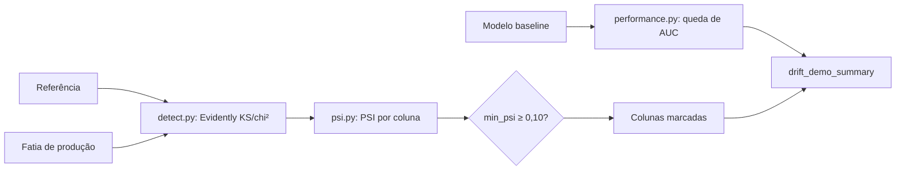

<!--
================================================================================
LOG DE MANUTENÇÃO DE DOCUMENTAÇÃO
--------------------------------------------------------------------------------
Data       | Autor          | Descrição
--------------------------------------------------------------------------------
2026-10-25 | Eduardo Batista | Registro consolidado do fechamento das pendências das Etapas 1 e 2.
================================================================================
-->

# Registro de Desenvolvimento — 2026-10-25

| Metadado | Detalhe |
| :--- | :--- |
| **Escopo Principal** | `src/drift/` (PSI, queda de AUC), qualidade e reprodução ponta a ponta |
| **Commits Gerados** | 7 (incluindo este registro) |
| **Arquivos Modificados** | 50+ (a maioria são relatórios e modelo regenerados) |
| **ADRs Vinculadas / Geradas** | `docs/adrs/0005-psi-e-queda-de-auc-como-sinais-de-drift.md` |

---

## 1. Visão Geral das Alterações

Fechamento das pendências das Etapas 1 e 2 levantadas na validação de 2026-10-21, deixando tudo pronto para a Etapa 3. O drift passou a reportar PSI (tamanho do efeito) e a queda de ROC-AUC (sinal real de concept drift); a cobertura subiu de 67,89% para 95%; e o pipeline foi reproduzido ponta a ponta com o dataset real do Kaggle, regenerando o baseline e os relatórios.

---

## 2. Arquitetura Afetada & Decisões (ADRs)

- **Decisões Registradas:**
  - `docs/adrs/0005-psi-e-queda-de-auc-como-sinais-de-drift.md`: PSI por coluna com filtro opcional `min_psi` (ligado na demo) e queda de ROC-AUC como sinal de concept drift. O teste do Evidently sobre `target` mede só label shift.

---

## 3. Mapa de Arquivos Modificados

| Arquivo | Camada Técnica | Resumo da Modificação |
| :--- | :--- | :--- |
| `src/drift/psi.py` | Domínio | PSI numérico (decis da referência) e categórico |
| `src/drift/performance.py` | Domínio | Queda de ROC-AUC vs baseline |
| `src/drift/detect.py`, `demo.py` | Aplicação | PSI em `ColumnDrift`, `min_psi`, seção `performance` |
| `src/config.py` | Configuração | Limiares `PSI_MODERATE`, `PSI_SIGNIFICANT`, `AUC_DROP_ALERT` |
| `tests/integration/test_pipeline_e2e.py` | Teste | Pipeline completo em sandbox sintético |
| `tests/test_psi.py`, `test_download.py`, `test_detect.py` | Teste | PSI, performance, download e CLI de detecção |
| `pyproject.toml`, `uv.lock` | Infra | `evidently>=0.7`; `fail_under = 80` |
| `models/`, `reports/` | Artefatos | Regenerados com o dataset real |
| `README.md`, `docs/`, `CHANGELOG.md` | Documentação | Limitações, números reais, ADR-0005, checklist |

---

## 4. Detalhamento por Commit

### `feat(drift): calcular PSI e queda de AUC como sinais de drift`
- **Razão:** KS gera falso alerta em amostra grande; o teste sobre `target` não detecta concept drift.
- **Comportamento atual:** toda coluna traz PSI; a demo filtra com `min_psi=0,10` e reporta `performance`.
- **Arquivos:** `src/drift/{psi,performance,detect,demo}.py`, `src/config.py`, `tests/test_psi.py`, `tests/test_detect.py`.

### `test(pipeline): cobrir pipeline ponta a ponta e download em sandbox`
- **Razão:** cobertura de 67,89% e `demo.py`, `validation/demo.py`, `download.py` com 0%.
- **Comportamento atual:** roda os `main()` reais em diretório temporário, sem tocar `data/`, `models/` ou `reports/`.
- **Arquivos:** `tests/integration/`, `tests/test_download.py`.

### `build(quality): fixar evidently>=0.7 e elevar piso de cobertura para 80`
- **Razão:** o código usa a API 0.7; meta do repositório é ≥ 80%.
- **Arquivos:** `pyproject.toml`, `uv.lock`.

### `docs(adr): registrar ADR 0005 sobre PSI e queda de AUC`
- **Arquivos:** `docs/adrs/0005-*.md`, `docs/adrs/README.md`.

### `chore(reports): regenerar baseline e relatorios com o dataset real`
- **Razão:** reprodução ponta a ponta (checklist 4.3) e `psi`/`performance` nos artefatos.
- **Comportamento atual:** ROC-AUC 0,7491 (antes 0,7494) por diferença de ambiente; t0 sem falso alerta; t2 com queda de AUC de 0,181.
- **Arquivos:** `models/*`, `reports/**`.

### `docs(etapas): atualizar README, docs das etapas 1-2, CHANGELOG e checklist`
- **Arquivos:** `README.md`, `CHANGELOG.md`, `docs/etapa-{1,2}-*.md`, `docs/tech-challenge-fase4-checklist.md`.

### `chore(gitignore): ignorar graphify-out tambem como symlink`
- **Arquivos:** `.gitignore`.

---

## 5. Dívida Técnica & Próximos Passos

- [ ] Etapa 3: usar `min_psi=PSI_MODERATE` e `performance.*.degraded` como métricas de saúde e alertas; centralizar `logs/pipeline.jsonl`.
- [ ] PSI por decis é sensível a valores repetidos (ex.: `income_total` com rendas redondas, PSI 0,76 com choque de +15%); considerar faixas ajustadas a empates se isso gerar ruído.
- [ ] Concept drift depende de rótulos de feedback; sem rótulos só há data drift e PSI.
- [ ] O PDF `docs/MLET - Tech Challenge - Fase 4.pdf` segue untracked (decidir se versiona).
